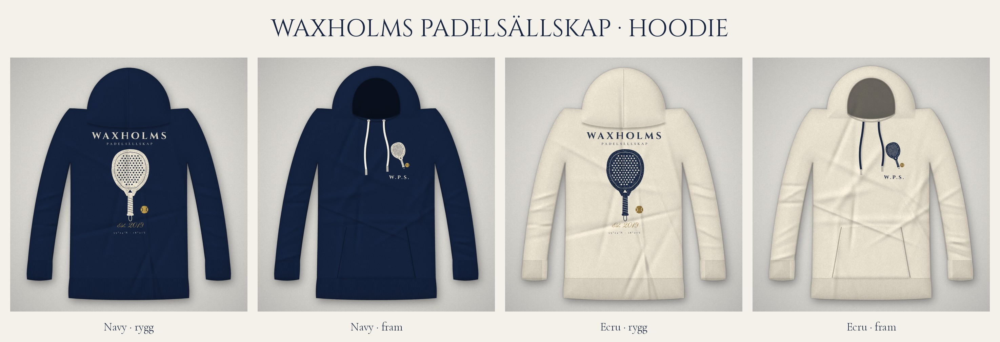

# Waxholms Padelsällskap: hoodie

Stort, rent tryck på ryggen och en liten bröstlogga fram. Tyst rikt: skärgård, padel och koordinater, inga pengaskämt.

**Ryggtryck:** WAXHOLMS / PADELSÄLLSKAP, ett padelracket med boll, *Est. 2019* och 59°24′N · 18°21′E (Vaxholm).
**Bröst (vänster sida):** litet racket, boll och "W.P.S."

| Hoodie | Tryckfärg | Filer |
|---|---|---|
| Navy | Creme och guld | `prints/*-for-navy-hoodie.png` |
| Ecru | Marinblå och brons | `prints/*-for-ecru-hoodie.png` |

Tryckfilerna är genomskinliga PNG:er i hög upplösning. Rekommenderad storlek är ca 30 cm bred på ryggen och ca 8 cm bred på bröstet.
Typsnitten är Cinzel, Cormorant Garamond och Pinyon Script (gratis från Google Fonts). Koden i `source/` renderar trycken och mockuperna.
