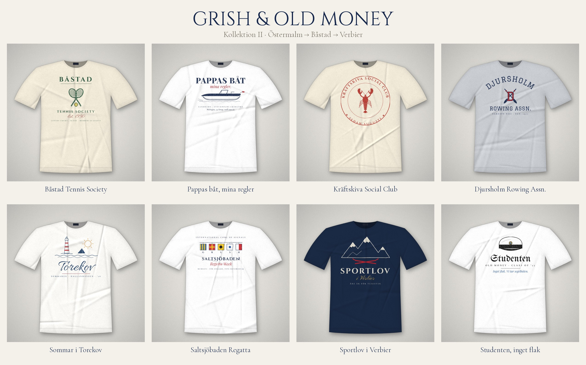

# Grish & Old Money: Kollektion II

Eight T-shirt designs built on niche Swedish old-money references.

| # | Design | Shirt | The joke / reference |
|---|---|---|---|
| 01 | Båstad Tennis Society | Cream | Båstad tennis week, wooden rackets |
| 02 | Pappas båt, mina regler | White | "Dad's boat, my rules". Mahogany runabout in Sandhamn |
| 03 | Kräftskiva Social Club | Cream | August crayfish party, club-seal style |
| 04 | Djursholm Rowing Assn. | Heather grey | Collegiate varsity rowing crest |
| 05 | Sommar i Torekov | White | Summer on the Bjäre peninsula |
| 06 | Saltsjöbaden Regatta | White | The signal flags spell G-R-I-S-H |
| 07 | Sportlov i Verbier | Navy | "Åre är för turister" |
| 08 | Studenten, inget flak | White | Graduation: "No truck party, we're taking the sailboat" |

- `prints/`: print-ready transparent PNGs (up to 3000 px) to send to a print shop.
- `mockups/`: flat-lay product mockups, one per design.
- `source/`: design source (`designs.js`, `render.html`) and the mockup renderer (`mockup.py`).
  The fonts are free Google Fonts: Cinzel, Cormorant Garamond, Playfair Display, Pinyon Script, Graduate, UnifrakturMaguntia and Allura.
